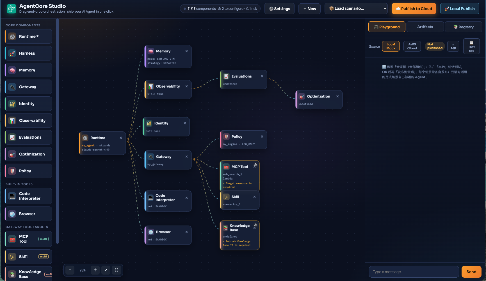
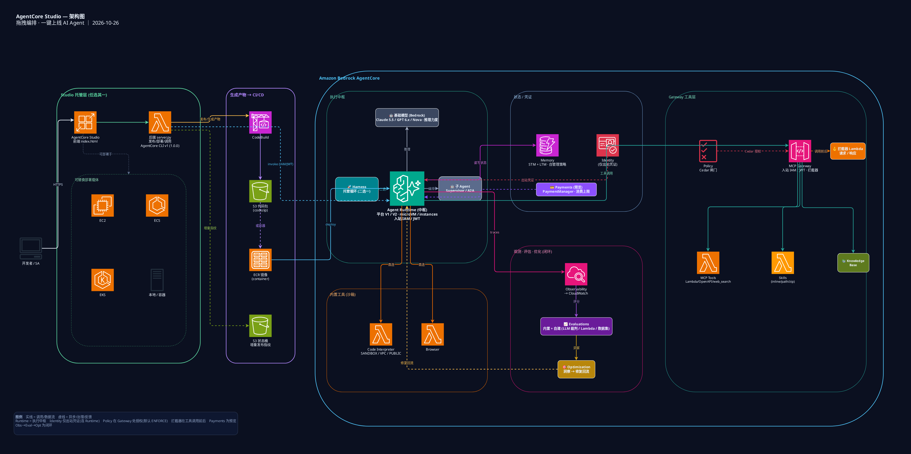
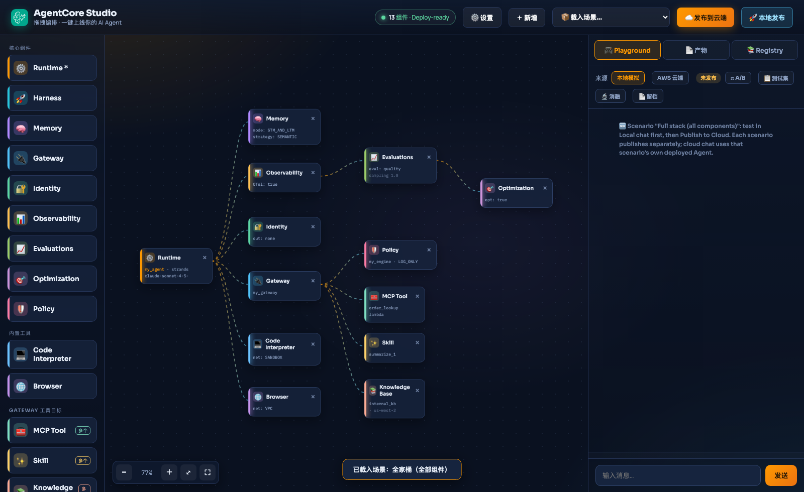
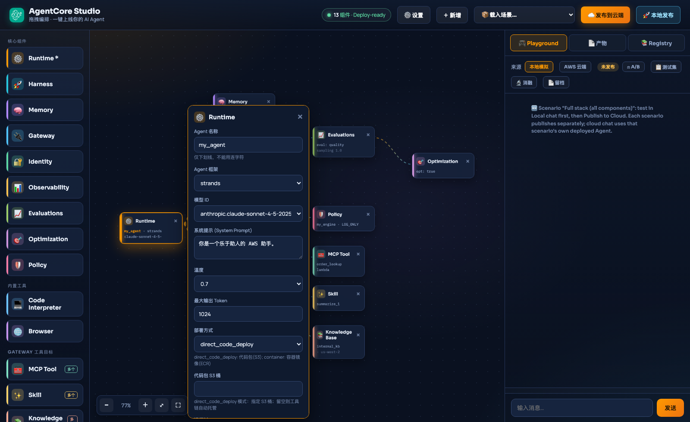
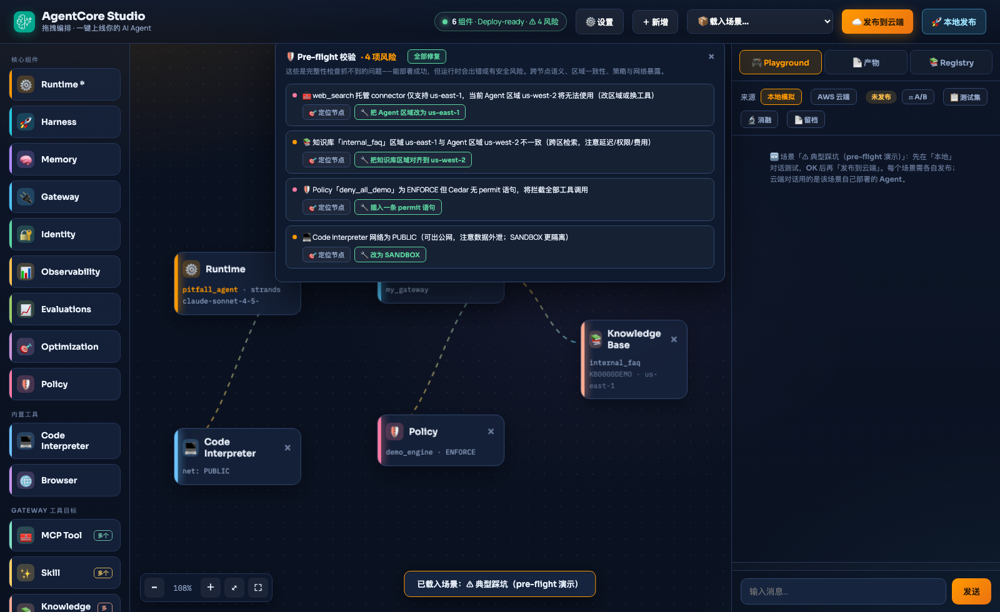
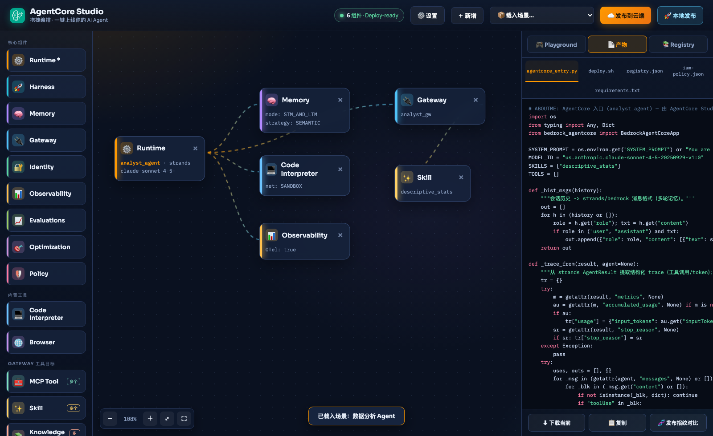
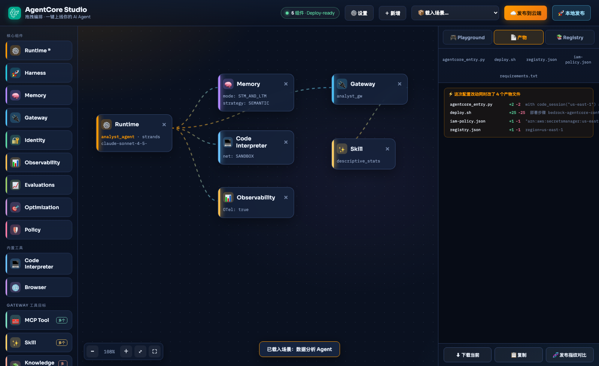
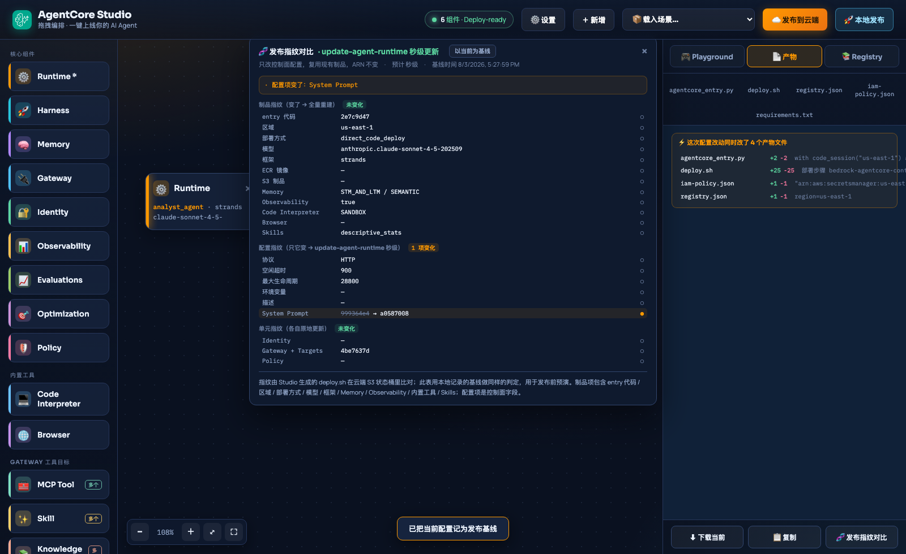
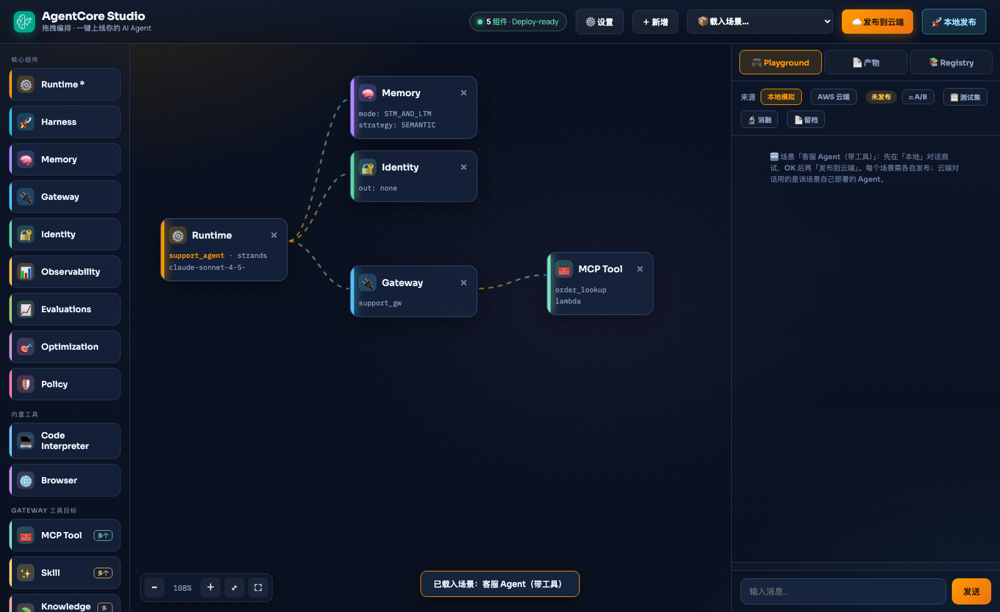
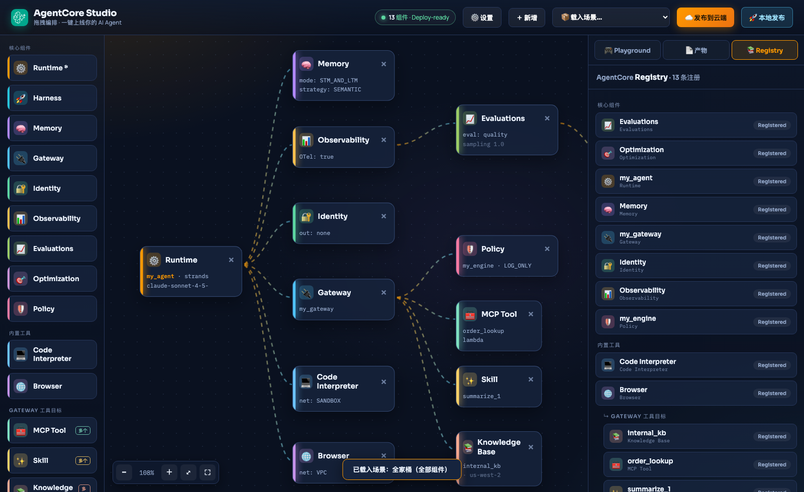

# AgentCore Studio

> Drag, orchestrate, ship your AI Agent in one click ｜ From canvas to cloud in minutes
>
> 🌐 English ｜ [中文](README.md)

**AgentCore Studio** is a visual orchestration workbench for Amazon Bedrock AgentCore. On the canvas you drag in core components — Runtime / Harness, Memory, Gateway, Identity, Observability, Policy — plus the Code Interpreter and Browser built-in tools and the MCP tools / Skills mounted under a Gateway, assembling an AI Agent like building blocks. Every configuration change **generates real, deployable artifacts in real time** (entry code, deploy script, IAM policy, component registry) and registers them instantly in the Registry. When you're done, **publish to the cloud in one click** for a real deployment to AWS, then chat with the Agent directly in the built-in **Playground** to verify it: locally wired to real Bedrock for sub-second feedback, and trustworthy when running in the cloud.



## Architecture



> Developers orchestrate by dragging in Studio (deployable on App Runner / EC2 / ECS / EKS / locally) → the generated artifacts are deployed via CI/CD (CodeBuild → S3 → ECR) → the Agent Runtime in Amazon Bedrock AgentCore (platform V1 / V2, microVM / instances) drives Memory (incl. self-managed strategy), Identity, Payments (preview), Policy, Observability / Evaluations (incl. custom evaluators), the Gateway tool layer (incl. interceptors), and the built-in sandbox tools; deploys go through AgentCore CLI v1. The editable source is in [`architecture.drawio`](architecture.drawio).

## Features

### 🎨 Visual orchestration
- Drag-and-drop all AgentCore components; click a node to edit it in a popover, with field interlocks on dropdown change (e.g. Skill source inline/path/upload, Identity inbound/outbound, Gateway IAM/JWT, Policy Cedar/natural-language, Runtime code source ECR/S3)
- ⚙️🚀 **Dual hub — Runtime or Harness**: Runtime (ships its own orchestration code, deployed as a container/artifact) or Harness (declarative, AgentCore-managed agent loop, with immutable versions + named endpoints for instant rollback) — pick one, switch as needed
- 🧬 **Runtime platform version V1/V2 + compute type**: the Runtime node offers V1 (default, READY in seconds) or V2 (snapshot start, consistent cold starts); choosing V2 narrows regions to the 5 supported ones, tightens the env-var limit to 1.5KB/2.5KB with live usage, adds pre-flight notes (updates take minutes, /ping must be healthy within 120s), and the deploy script applies it via `update-agent-runtime --platform-version` and polls until READY; compute type instances (capacity provider, sessions up to 14 days) raises the timeout ceiling to 1209600s
- ✨ **AI-generated canvas (NL→Canvas)**: describe the agent you want in one line and get an **editable canvas** of nodes and edges generated automatically; keep dragging to refine, with automatic pre-flight checks
- 🧠 **Deep Generate**: 4-step intelligent orchestration (requirement decomposition → component config → System Prompt → validation) with SSE real-time progress streaming; auto-generates complete deployable artifacts + architecture decision rationale + pre-deploy report; results apply to canvas in one click
- ⏰ **Scheduled triggers (EventBridge Scheduler)**: automatically introduced when the requirement includes periodic execution; deploy script generates `aws scheduler create-schedule` + IAM Role, supporting cron/rate expressions
- 📦 **One-click scenario templates**: minimal chat / customer support (with tools) / data analysis / the full stack / ⚠ classic pitfalls — fill the canvas in seconds
- 🔗 Accurately-related edges (Runtime is the hub; MCP/Skill hang under the Gateway)

### 🎮 Playground: sub-second local verification → iteration loop
- **Locally connects straight to Bedrock `converse` for real model replies** / or the AWS cloud source; the source is **labeled honestly**: Local · live (runs the tools you orchestrated) / Local · model (model only, tools not run) / Local sim / AWS cloud
- **System Prompt edits take effect instantly** — the system prompt is passed to the Agent on every turn, so tweaking one line shows the new behavior immediately, no redeploy
- 🔍 **Trace inspection**: expand any reply to see tool calls (inputs/results), token usage, latency, and model — one data source shared by local and cloud
- ⚖️ **A/B compare**: same input, baseline vs candidate System Prompt side by side, so you can tell directly whether a change made things better or worse
- 📋 **Test set**: save a group of inputs and run them all in one click; results are **diffed against the last run** (new / changed / unchanged) for lightweight regression
- 🔬 **Component ablation + assertions**: switch one component off and run a preset probe designed so the task *cannot* be done without it, with machine-checkable assertions (expects a specific tool call / expects an exact value). A (with) and B (without) each **genuinely republish the artifacts and get invoked once**, then a side-by-side verdict: `ASSERT PROVEN / NOT REQUIRED / PROBE MISS / BEHAVIOR DIFF / ARTIFACT DIFF`. Ablating a Gateway cascades to the components mounted under it; if a component never reaches the agent code (e.g. Memory) or the locally callable tool set is unchanged (e.g. cloud-only Gateway targets such as web_search), it reports `LOCAL N/A` and skips the model calls instead of producing a misleading "no difference"
- 📄 **Demo evidence export**: one click exports a Markdown file — canvas components and key config, pre-flight findings, every turn (tool inputs/outputs, tokens, latency), assertion results, artifact diffs, all five generated artifacts in full, plus a notes section. You leave with a file you can hand to a customer, not a memory
- 💾 **Persistent chat history**: each Agent's chat and history are stored locally and survive a refresh

### 📄 Real-time artifacts & publishing
- Generates `agentcore_entry.py` / `deploy.sh` / `iam-policy.json` / `requirements.txt` / `registry.json` in real time; the Registry logs all components, built-in tools, and MCP/Skills
- ⚡ **Live artifact diff**: change one setting and the artifact panel immediately lists **every file that changed together**, with a semantic summary (new tool functions / IAM statements and permissions / inline role policies / deploy steps / dependencies) and green highlighting for added lines in the current file. One feature node = tool code + the matching least-privilege IAM + deploy step + registry record, all appearing at once (e.g. enabling Observability → `deploy.sh` +1 step, `iam-policy.json` +5 lines with `logs:*`/`xray:*`, `registry.json` +2, `requirements.txt` +1)
- ✅ **Pre-flight validation**: beyond completeness checks, it runs **cross-node semantic / region / safety** checks (Runtime V2 in an unsupported region, web_search in an unsupported region, cross-region knowledge bases, an ENFORCE Policy with no permit locking everything, public-egress risk, etc.), showing a live "risk" count in the status bar at design time and prompting before deploy
- 🛡️ **Risk panel + one-click fixes**: click the status bar to expand each risk, with "🎯 Locate" to jump to the offending component and a targeted fix (change region / align the knowledge-base region / insert a permit statement / switch network back to SANDBOX). "Fix all" converges iteratively (fix one → re-evaluate), because one fix can change another's verdict. Pair it with the ⚠ classic-pitfalls scenario to trigger all four risk classes at once
- 🚀 **Publish pipeline trace**: shows the component publish path while publishing, lighting up step by step (pending → in progress → ✓); runs as a background job + progress polling (immune to streaming timeouts), with live logs and a deploy-timer heartbeat
- ⚡ **Incremental publish (three states)**: judged by fingerprint — artifact/code changed → full rebuild; control-plane config only (protocol/timeout/env vars/description, etc.) → `update-agent-runtime` second-level update (reuses the artifact, keeps the ARN); unchanged → skipped. Identity / MCP Target / Policy / Memory / Gateway all support in-place fast updates
- 🧬 **Publish fingerprint diff**: rehearse which path a publish will take. It lists the artifact fingerprint (entry code / region / deploy type / model / framework / Memory / Observability / built-in tools / Skills) and the config fingerprint (protocol / timeouts / env vars / description / System Prompt) item by item as **changed / unchanged**, with the verdict and an ETA — so it is obvious why editing one line of System Prompt is a second-level update while switching models forces a rebuild
- ☁️ **One-click publish to the cloud**: if it hasn't been published locally it auto-publishes first, then does a real deployment to AWS Bedrock AgentCore (in-place update — the old version keeps serving during the rebuild) and switches to the Playground to watch live progress; auto-detects an already-ready cloud Agent as a demo fallback

### 🧩 Multi-agent & reuse
- **Multi-agent orchestration**: pull already-published agents from the cloud and generate an orchestrator Agent in one click — Supervisor (the controller wraps each sub-agent as a tool and calls it on demand) or A2A (collaborate with peer agents by passing JSON-RPC `message/send` through `InvokeAgentRuntime`; A2A mode only lists agents deployed with `--protocol A2A`). The canvas automatically draws the orchestrator↔sub-agent relationships
- **Import an existing Agent to keep editing**: on publish, the entire canvas configuration is archived to the S3 state bucket (`specs/<name>.json`); on import, Studio pulls the cloud agent list and cross-marks which are "importable", then one click reads the config back and **rebuilds an editable canvas** to tweak and re-publish. Works only for agents published by Studio

> Details: model IDs automatically get the cross-region inference profile prefix per region (`us.`/`eu.`/`apac.`); default region `us-west-2`, default model Claude Sonnet 5.5 (also Opus 5.5, Haiku 5.5, GPT 6.1 / 6; temperature is omitted for these newer models); switching deploy region auto-cleans toolkit local state left over from another region.
>
> Memory long-term strategies support `SEMANTIC / SUMMARY / USER_PREFERENCE / EPISODIC / CUSTOM` (mapping to the API's `*MemoryStrategy`); `STM` keeps only the event stream with no strategies, while `LTM` appends them in place via `update-memory --memory-strategies`. A Policy's enforcement mode (`LOG_ONLY` / `ENFORCE`) takes effect through the Gateway's `policyEngineConfiguration`, not as a parameter of the policy engine itself.
>
> `Evaluations` picks a built-in metric family (quality / tool_use / trajectory / safety / all, drawn from the built-in evaluators listed by `agentcore eval evaluator list`; custom LLM-judge / Lambda code evaluator IDs can be added too) and wires it up on publish via `agentcore eval online create` — continuous online evaluation against the chosen endpoint at the configured sampling rate. `Optimization`'s configuration bundle uses `create-configuration-bundle` to snapshot the System Prompt / model / sampling parameters as an immutable version (`components` is `{component ARN: {configuration: free-form JSON}}`). For `Observability`, log level / trace switch / sampling rate become standard OpenTelemetry SDK environment variables (`OTEL_LOG_LEVEL` / `OTEL_TRACES_EXPORTER` / `OTEL_TRACES_SAMPLER`), and the dashboard switch creates four widgets via `cloudwatch put-dashboard` (invocations / errors / p50-p95 latency / tokens / error logs).

## Screenshots

<table>
<tr>
<td width="50%"><br><sub>13 components on the canvas: Runtime is the hub, Gateway is the tool entry</sub></td>
<td width="50%"><br><sub>Click any component to see its real, editable fields</sub></td>
</tr>
<tr>
<td><br><sub>Pre-flight: cross-node risks caught before deploy, with locate + one-click fix</sub></td>
<td><br><sub>Real deployable artifacts generated live: entry code / deploy script / IAM / registry</sub></td>
</tr>
<tr>
<td><br><sub>Change one setting, four artifact files change together</sub></td>
<td><br><sub>Fingerprint verdict: System-Prompt-only change → second-level update, no rebuild</sub></td>
</tr>
<tr>
<td><br><sub>Playground: validate by chat without deploying, with honest source labels</sub></td>
<td><br><sub>Every component, built-in tool and MCP/Skill is registered live in the Registry</sub></td>
</tr>
</table>

## Run locally
```bash
python3 server.py            # open http://127.0.0.1:8799
# custom port / enable access password:
PORT=9000 STUDIO_PASSWORD=yourpass python3 server.py
```
> The backend executes the generated code and calls the `agentcore` CLI. It binds to `127.0.0.1` only by default — do not expose it to the public internet without authentication.

## Files
| File | Description |
|---|---|
| `index.html` | Single-file frontend (fonts inlined, works offline) |
| `server.py` | Zero-dependency backend (publish / Playground / deploy / cloud invocation / NL→Canvas / Deep Generate relay) |
| `deep_generate.py` | Deep Generate engine (4-step LLM orchestration + parallel optimization + SSE streaming progress) |
| `Dockerfile` | Container image (bundles agentcore CLI + AWS CLI + zip) — optional, for packaging onto any container platform |


## Presentation decks

Share-ready decks organized as "feature → scenario → value", each followed by 8 real-UI screenshots:

| File | Audience | Notes |
|---|---|---|
| `AgentCore-Studio_客户方案介绍_20260729.pptx` | Customer | Value journey: from idea to cloud, built-in security/compliance, cost and path to production |
| `AgentCore-Studio_内部技术分享_SA_30min_20260729.pptx` | Internal SA | Four-stage customer journey + a one-page AgentCore mechanics cheat sheet (internal use) |

> The internal SA deck contains SA-facing positioning and is for internal sharing only. Screenshot sources are in `docs/screenshots/`.
